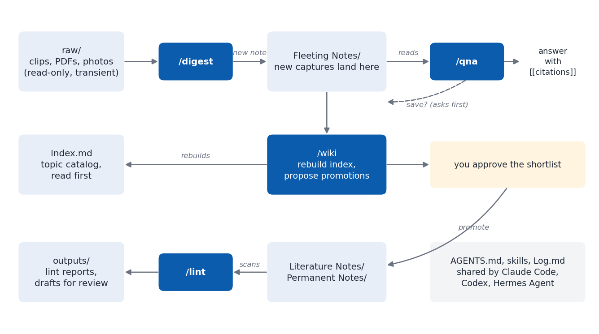

# llm-wiki-vault

An Obsidian Zettelkasten that AI coding agents maintain for you. One instruction file (`AGENTS.md`) and five small skills let **Claude Code**, **OpenAI Codex**, and **Hermes Agent** capture sources, keep an index, answer questions from your notes, and check the vault's health, while you approve every note that becomes permanent.

It adapts Andrej Karpathy's [LLM Wiki](https://gist.github.com/karpathy/442a6bf555914893e9891c11519de94f) idea to a Zettelkasten (fleeting, literature, and permanent notes) and to several agents sharing one vault. The design is explained in [this post](https://quantfin.net/posts/llm-wiki-external-brain/).



## What you get

```
your-vault/
  AGENTS.md            rules every agent reads (edit freely)
  CLAUDE.md            one line: @AGENTS.md
  Index.md             topic catalog, rebuilt by /wiki
  Log.md               append-only history, one line per change
  wiki_lint.py         link checker that /lint runs
  raw/                 inbox of sources (agents only read it)
  Fleeting Notes/      quick captures
  Literature Notes/    syntheses you approved
  Permanent Notes/     reference notes
  Files/  Templates/  outputs/
  .claude/skills/      skills for Claude Code
  .agents/skills/      the same skills for Codex and Hermes Agent
```

| Skill | What it does |
|-------|--------------|
| `/digest` | Turns a file in `raw/`, a URL, or pasted text into a new fleeting note that cites its origin. |
| `/wiki` | Rebuilds `Index.md` and proposes fleeting notes ready for promotion. Writes nothing until you approve. |
| `/qna` | Answers a question from your notes with a wikilink citation for each note used. |
| `/lint` | Finds broken links, links into `raw/`, orphans, bad frontmatter, and contradictions. Fixes only mechanical problems; reports the rest. |
| `/explain` | Writes a self-contained HTML explainer page about a topic into `outputs/`. |

## Install

You need bash, git, and Python 3 (for `wiki_lint.py`). Obsidian is optional but recommended.

**From a clone** (read the script first, it is short):

```bash
git clone https://github.com/baobach/llm-wiki-vault.git
cd llm-wiki-vault
./install.sh ~/external-brain
```

**In one line**, pinned to a release:

```bash
curl -fsSL https://raw.githubusercontent.com/baobach/llm-wiki-vault/v0.1.0/install.sh | bash -s -- ~/external-brain
```

The installer never overwrites an existing file, so you can also point it at an **existing vault**: it adds the folders, `AGENTS.md`, the skills, and the linter, and leaves your notes alone. If you already have an `AGENTS.md`, it is kept; copy the rules you want from [`template/AGENTS.md`](template/AGENTS.md) into it.

Options: `--no-git` skips `git init`, `--ref <tag>` picks another release for the one-line install, `--update-skills` updates the skills (see below).

**Skills only.** To add just the skill files to a project with the [skills CLI](https://github.com/vercel-labs/skills), run `npx skills add baobach/llm-wiki-vault`. The skills expect the folders and the rules in `AGENTS.md`, so the installer above is the recommended path.

## Set up each agent

- **Claude Code**: run `claude` inside the vault. Type `/digest`, `/qna`, `/wiki`, `/lint`, or `/explain`, or just ask, since skills also trigger from their descriptions.
- **Codex**: run `codex` inside the vault. Codex reads `AGENTS.md` and the skills in `.agents/skills/`; type `$digest` or pick a skill from `/skills`.
- **Hermes Agent**: trust the vault once per machine so Hermes loads `.agents/skills/`. The command replaces the whole list, so include folders you already trust:

  ```bash
  hermes config set skills.trusted_project_dirs '["/path/to/your-vault"]'
  ```

  `AGENTS.md` gives Hermes a smaller role (`/qna` and `/digest` into new notes only), which suits a small local model. Don't create a `.hermes.md`: Hermes would read it instead of `AGENTS.md`.

In Obsidian, open the folder as a vault, point the core Templates plugin at `Templates/`, and set the [Web Clipper](https://obsidian.md/clipper) output folder to `raw/`. The [obsidian-git](https://github.com/Vinzent03/obsidian-git) plugin keeps the vault backed up to a **private** repository.

## Daily use

1. Clip an article into `raw/` (or paste a link) and run `/digest`.
2. Ask questions with `/qna`, or `/explain <topic>` for a whole topic.
3. About once a week, run `/wiki` to refresh the index and review promotions.
4. Every few weeks, run `/lint`.

Several agents can work in the same vault: a write lock (`.locks/`) keeps agents on one machine from writing at the same time, and the "Git sync" rules in `AGENTS.md` cover agents on other machines.

## Update

```bash
cd llm-wiki-vault && git pull
./install.sh --update-skills ~/external-brain
```

`--update-skills` replaces the skills and `wiki_lint.py` with the new version, keeps every replaced file as `*.bak-<timestamp>`, records the version in `.llm-wiki-vault-version`, and adds a line to `Log.md`. It never touches `AGENTS.md` or your notes; compare your `AGENTS.md` with [`template/AGENTS.md`](template/AGENTS.md) for new rules. See [CHANGELOG.md](CHANGELOG.md).

## Customize

All behavior lives in plain Markdown. Change the folder roles, frontmatter, writing style, or agent roles in your vault's `AGENTS.md`; every agent reads it on each session. Edit a skill in `.claude/skills/<name>/SKILL.md` and copy it to `.agents/skills/<name>/` so Codex and Hermes follow the same steps.

## Privacy

The kit contains no personal data and makes no network requests after install. Your vault does hold personal data: keep its git remote private, and never put API keys or credentials in notes, since every agent you run there can read them.

## Develop

```bash
bash tests/run.sh        # install, rerun, update, and linter tests
shellcheck install.sh tests/run.sh
```

CI runs the tests on Linux and macOS. To release: bump `VERSION` and the default `REF` in `install.sh`, update `CHANGELOG.md`, then tag `vX.Y.Z`; the release job installs from the new tag with the one-line command.

## Credits and license

Built on Andrej Karpathy's [LLM Wiki](https://gist.github.com/karpathy/442a6bf555914893e9891c11519de94f) gist and his [thread on LLM output formats](https://x.com/karpathy/status/2105819303471976479) (the writing-style rule). MIT licensed, see [LICENSE](LICENSE).
